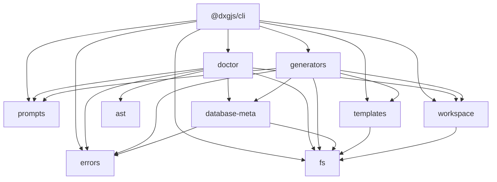

# DXG Dependency Graph

This graph is derived from the `dependencies` of each `package.json`. Arrows point from a package to the package it depends on.

## Levels

A package only depends on packages from a lower level.

| Level | Packages | Internal dependencies |
| --- | --- | --- |
| 0 | `errors`, `ast`, `prompts`, `fs` | none |
| 1 | `database-meta` | `errors`, `fs` |
| 1 | `templates` | `fs` |
| 1 | `workspace` | `fs` |
| 2 | `generators` | `database-meta`, `errors`, `fs`, `prompts`, `templates`, `workspace` |
| 2 | `doctor` | `ast`, `database-meta`, `errors`, `fs`, `prompts`, `workspace` |
| 3 | `@dxgjs/cli` | `doctor`, `errors`, `fs`, `generators`, `prompts`, `templates`, `workspace` |

## Rules

1. **No cycles.** A new internal dependency must point to a lower level.
2. **Libraries never depend on the CLI.** Only `apps/cli` depends on the other packages.
3. **Features stay independent.** `generators` and `doctor` do not depend on each other; what they share lives in `database-meta`.
4. **Domain knowledge is shared, not duplicated.** Provider, script and path rules live in `@dxgjs/database-meta`.

Nothing in CI enforces these rules automatically yet, so review dependency changes in pull requests.

## External dependencies

| Package | Runtime dependencies |
| --- | --- |
| `@dxgjs/cli` | `commander`, `picocolors` |
| `@dxgjs/ast` | `magicast`, `json5` |
| `@dxgjs/doctor` | `picocolors` |
| `@dxgjs/fs` | `fast-glob`, `package-manager-detector` |
| `@dxgjs/generators` | `picocolors` |
| `@dxgjs/prompts` | `@clack/prompts` |
| `@dxgjs/database-meta`, `@dxgjs/errors`, `@dxgjs/templates`, `@dxgjs/workspace` | none |
